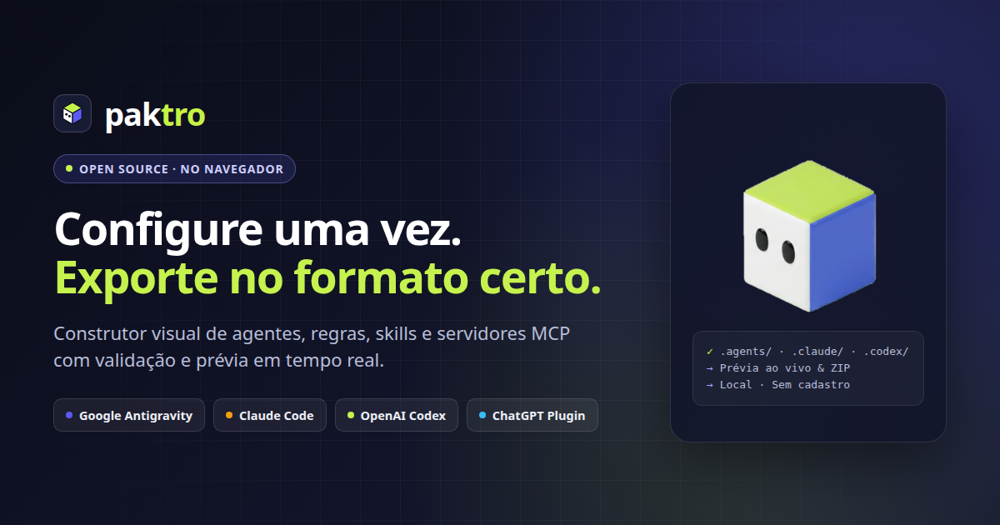

# Paktro

Construtor visual multiplataforma de pacotes de agentes de IA (**Google Antigravity**, **Claude Code**, **OpenAI Codex** e **ChatGPT Plugin**). Interface em português, gratuita e 100% no navegador, sem conta, banco de dados ou API de aplicação. O editor, a validação, a conversão entre plataformas, os backups e a geração de ZIP funcionam localmente no cliente. A ponte MCP (**Paktro Bridge**) é um programa local opcional e separado.



## Plataformas e formatos suportados

Cada destino possui seu próprio adaptador, catálogo nativo e mapeamento versionado em `src/platforms/`:

| Plataforma | Mapeamento | Arquivos gerados |
| --- | --- | --- |
| **Google Antigravity** | `antigravity-2026-11-24` | `.agents/agents/<slug>.md`, `.agents/rules/*.md`, `.agents/skills/*/SKILL.md`, `.agents/mcp_config.json`, `PAKTRO-SETUP.md` (modelos de sessão) |
| **Claude Code** | `claude-code-2026-11-24` | `.claude/agents/<slug>.md`, `.claude/rules/*.md`, `.claude/skills/*/SKILL.md`, `.mcp.json`, `CLAUDE.md` opcional (bloco gerenciado), `PAKTRO-SETUP.md` |
| **OpenAI Codex** | `codex-2026-11-24` | `AGENTS.md` (bloco gerenciado), `.codex/agents/<slug>.toml`, `.agents/skills/*/SKILL.md`, `.codex/config.toml` (mesclado via parser TOML), `PAKTRO-SETUP.md` |
| **ChatGPT Plugin** | `chatgpt-plugin-2026-11-24` | `plugin.json` (`agent-plugins.org` 1.0.0), `skills/*/SKILL.md`, `mcp.json` (`$schema` + `streamable-http` remoto), `PAKTRO-SETUP.md` |

Além disso, todo ZIP exportado inclui `paktro.json` para backup e reimportação fiel no editor.

## Executar localmente

Requer Node.js 22 ou superior e npm (apenas para rodar a aplicação e a ponte opcional — os agentes gerados funcionam em projetos de qualquer linguagem).

```sh
npm ci
npm run dev
```

Abra **http://localhost:3000**. Para gerar e servir a versão estática de produção:

```sh
npm run build
npm start
```

`out/` contém o site estático (`output: "export"`), pronto para hospedar na Vercel ou em qualquer servidor estático na raiz do domínio. `npm start` serve essa pasta em loopback; `PORT` ou `--port` muda a porta. A compilação não depende de fontes, imagens ou APIs externas.

> **Uso hospedado (Vercel) vs. Ponte local:** toda a criação, validação, conversão entre plataformas, importação/exportação de ZIP e backups JSON funciona normalmente no navegador pela versão hospedada. Já a **Paktro Bridge** escuta em `127.0.0.1` localmente; navegadores costumam pedir permissão ou bloquear requisições de origens HTTPS remotas para `127.0.0.1`, então para usar a sincronização ao vivo com a IA rode o app localmente (`npm run dev` ou `npm start`).

## O que está implementado

- **Biblioteca local de conjuntos** (cada conjunto contém agente, regras, skills, servidores MCP e configuração específica da plataforma), com criação, renomeação, duplicação, exclusão confirmada, busca, ordenação, etiquetas e comparação lado a lado.
- **Cinco templates universais** (agnósticos de linguagem): revisor de código, desenvolvedor frontend, analista de segurança, especialista em testes e agente genérico — com escolha imediata do destino ao criar.
- **Editor guiado em quatro etapas:**
  1. **Identidade:** destino do pacote (com conversão assistida entre plataformas e aviso explícito de adaptações/perdas), nome, slug, especialidade, objetivo, instruções avançadas e seleção de modelo/esforço nativa de cada plataforma.
  2. **Ferramentas:** seleção de papéis/exposição, políticas de permissão/sandbox e catálogo de ferramentas nativas por plataforma (21 ferramentas confirmadas para Antigravity, 18 ferramentas oficiais de subagente + `disallowedTools` + `memory`/`maxTurns`/`omitClaudeMd` para Claude Code, controle de `shell_tool` para Codex).
  3. **Regras e skills:** galeria e edição visual com os quatro modos de ativação (`always`, `automatic`, `path`/globs e `manual`), ativação/desativação e criação de procedimentos próprios.
  4. **Integrações:** configuração visual de servidores MCP `stdio` e `Streamable HTTP` sem executar comandos nem armazenar credenciais no editor, com guia de conexão por plataforma.
- **Prévia imediata de árvore e código**, destaque simples de sintaxe, cópia, download individual, exportação em ZIP validada (bloqueia inconsistências críticas como `stdio` em plugin web do ChatGPT) e backup JSON versionado (`paktro.json`).
- **Persistência automática** em `localStorage` (`paktro:library:v2`, com migração retrocompatível de `agex:library:v2`, `agex:library:v1` e `agent-studio:library:v1`), tratamento de indisponibilidade/cota/corrupção e detecção de alterações em outra aba.
- **Importação multiplataforma** de arquivos `.md`, `.toml`, `.json` e pacotes `.zip` (Antigravity, Claude Code, Codex e ChatGPT Plugin), com detecção automática de formato e resolução de ambiguidade quando necessário.
- **Ponte MCP local bidirecional (`Paktro Bridge`)** com revisão visual, aprovação explícita (**Dar OK**) vinculada a hash de conteúdo, detecção de conflitos via `.paktro/manifest.json` e mesclagem não destrutiva de `AGENTS.md`, `CLAUDE.md`, JSON e TOML.

Nenhum agente é executado pelo site. O conteúdo só sai do navegador em um download, uma cópia explícita ou uma sincronização autorizada com a ponte local.

## Modelos, ferramentas e compatibilidade

- **Google Antigravity:** o frontmatter documentado de subagentes customizados aceita `inherit`, `flash_lite`, `flash` ou `pro`. Ao selecionar modelos concretos de sessão (**Gemini 4 Neon** `low`–`xhigh`, **Gemini 4 Hydrogen** `low`–`xhigh`, **Gemini 4 Carbon** `low`–`high`, **Orchestrator** Neon/Carbon/Argon, **Claude Opus 5.5**, **Claude Sonnet 5.5**, ou os modelos legados em ciclo de descontinuação **Gemini 4 Argon** e **Gemini 3.8 Flash**), o Paktro exporta `model: inherit` no `.md` e gera `PAKTRO-SETUP.md` com os passos para ativar o modelo no seletor do App/IDE ou via CLI (`agy models`, `agy --agent <slug> --model <id>`). O catálogo reúne as 21 ferramentas documentadas em `src/templates/tools.ts`.
- **Claude Code:** usa aliases oficiais (`inherit`, `sonnet`, `opus`, `haiku`, `fable`) ou IDs completos (`claude-sonnet-5-5`, `claude-opus-5-5`, `claude-haiku-5-5`, `claude-fable-5-2`, além de `4-6`/`4-5`), níveis de esforço (`low` a `max`), `permissionMode`, `isolation` (`none`/`worktree`), `memory` (`user`/`project`/`local`), `maxTurns`, `omitClaudeMd` e 18 ferramentas nativas (`Read`, `Edit`, `Write`, `NotebookEdit`, `Glob`, `Grep`, `LSP`, `Bash`, `PowerShell`, `Monitor`, `WebFetch`, `WebSearch`, `Agent`, `Skill`, `ToolSearch`, `SendMessage`, `TaskStop`, `TodoWrite`). Regras sem `paths:` com ativação automática ou manual viram skills em `.claude/skills/`.
- **OpenAI Codex:** gera `AGENTS.md` com bloco delimitado `<!-- PAKTRO:BEGIN -->`, subagentes em `.codex/agents/<slug>.toml` (com modelos atuais `gpt-6.2-sol`, `gpt-6.2-astra`, `gpt-6.1-sol`, `gpt-6.1-terra`, `gpt-6-astra`, `gpt-6-luna` e esforços `low` a `ultra`), skills em `.agents/skills/` e `.codex/config.toml` mesclado estruturalmente via `smol-toml`. Regras `path` são anotadas em `AGENTS.md` sem gerar `AGENTS.override.md` na raiz.
- **ChatGPT Plugin:** gera `plugin.json` e `mcp.json` estritamente aderentes aos schemas `agent-plugins.org` `1.0.0`, `skills/*/SKILL.md` e suporte apenas para servidores remotos `streamable-http` (servidores `stdio` locais são bloqueados na validação).

Referências consultadas:

- [Antigravity — Modelos](https://antigravity.google/docs/models) · [CLI](https://antigravity.google/docs/cli/headless/) · [Agentes customizados](https://antigravity.google/docs/subagents) · [Regras](https://antigravity.google/docs/rules/) · [Skills](https://antigravity.google/docs/skills/) · [Hooks e ferramentas](https://antigravity.google/docs/hooks/#supported-tools) · [MCP](https://antigravity.google/docs/mcp/)
- [Claude Code — Sub-agents](https://code.claude.com/docs/en/sub-agents)
- [OpenAI Codex — Subagents](https://developers.openai.com/codex/subagents)
- [OpenAI — MCP / Plugins](https://developers.openai.com/api/docs/mcp)

### Importação e limites

Backups atuais usam `format: "paktro"`, `version: 2` (aceitando também backups v1/v2 legados `format: "agex"` e `format: "agent-studio"`). Versões desconhecidas são recusadas sem descartar a biblioteca existente. Os limites são 1 MB por importação/biblioteca, 100 agentes, 30 regras, 30 skills e 20 servidores MCP por agente. ZIPs têm limite de 200 entradas e 1 MB após descompactação; caminhos inseguros e YAML com aliases são recusados.

Se o armazenamento local estiver corrompido ou for alterado por outra aba, o salvamento automático é suspenso para evitar perda silenciosa — exporte o backup JSON antes de recarregar ou limpar os dados do site.

## Conectar servidores MCP (do agente vs. ponte do Paktro)

Existem duas conexões distintas:

1. **Servidores MCP usados pelo agente gerado** (etapa **Integrações**): o site gera o arquivo de configuração da plataforma escolhida (`.agents/mcp_config.json`, `.mcp.json`, `.codex/config.toml` ou `mcp.json`). Adicione segredos (`env`, `headers`, `oauth`) apenas localmente fora do editor para nunca versionar nem expor credenciais.
2. **Paktro Bridge** (tela **Ponte local**): conecta o próprio Paktro ao Antigravity/IDE via MCP para que a IA crie ou atualize conjuntos na sua biblioteca local (`pending_review`), você revise visualmente no navegador, clique em **Dar OK (aprovar para exportar)** e a IA (ou o próprio site) grave os arquivos no projeto com mesclagem não destrutiva.

## Paktro Bridge

A ponte acompanha o projeto e usa o SDK oficial MCP (`@modelcontextprotocol/sdk`). Não exige serviço pago nem acesso remoto.

```sh
npm ci
npm run bridge:build
node bridge/dist/cli.mjs --help
```

### MCP stdio: criar, revisar e exportar conjuntos

Adicione o servidor MCP à configuração do seu cliente (por exemplo, `.agents/mcp_config.json` do projeto ou `~/.gemini/config/mcp_config.json`), usando caminhos absolutos reais (se `--file` for omitido, o padrão é `~/.paktro/library.json`, aceitando fallback para `~/.agex/library.json` ou `~/.agent-studio/library.json` se já existirem):

```json
{
  "mcpServers": {
    "paktro": {
      "command": "node",
      "args": [
        "/caminho/paktro/bridge/dist/cli.mjs",
        "--file",
        "/caminho/.paktro/library.json"
      ]
    }
  }
}
```

Ou registre direto pelo CLI do Antigravity (use `--` antes do comando por causa da flag `--file`):

```sh
agy mcp add paktro -- node /caminho/paktro/bridge/dist/cli.mjs --file /caminho/.paktro/library.json
```

Ferramentas expostas pela ponte:

| Ferramenta | Entrada | Resultado |
| --- | --- | --- |
| `get_studio_catalog` | nenhuma (ou `target` opcional) | Plataformas, templates, modelos, ferramentas, permissões, regras e skills |
| `list_packs` | nenhum parâmetro | IDs, nomes, slugs, plataformas e status (`pending_review`, `approved`, `stale`) |
| `get_pack` | `id` UUID | Configuração, status de aprovação e prévia dos arquivos gerados |
| `validate_pack` | `id` UUID | Validade, status de aprovação, erros, bloqueadores e avisos |
| `create_agent` | nome, plataforma, template, campos... | Cria agente no Paktro como `pending_review` para revisão no navegador |
| `update_agent` | `id` UUID + alterações | Atualiza o conjunto e retorna o status para `pending_review` |
| `export_pack_to_project` | `id` UUID, `projectPath`... | Grava os arquivos no projeto **somente após o OK** e registra `.paktro/manifest.json` |

Por segurança, `export_pack_to_project` recusa qualquer escrita enquanto não houver **Dar OK** no hash exato do conteúdo e da plataforma atuais. Links simbólicos e caminhos fora do projeto são bloqueados, e arquivos existentes (como `AGENTS.md`, `CLAUDE.md`, `.mcp.json`, `.agents/mcp_config.json` e `.codex/config.toml`) são mesclados preservando configurações anteriores.

### Conexão ao vivo e sincronização navegador ↔ biblioteca local

Para sincronizar ao vivo com o navegador enquanto roda localmente, inicie a ponte HTTP apontando para o mesmo `--file` usado pelo MCP:

```sh
export PAKTRO_BRIDGE_TOKEN="$(node -e 'process.stdout.write(require("node:crypto").randomBytes(32).toString("hex"))')"
printf '%s\n' "$PAKTRO_BRIDGE_TOKEN"
node bridge/dist/cli.mjs --http --origin http://localhost:3000 --port 4319 --file /caminho/.paktro/library.json
```

*(Para uso rápido em `http://localhost:3000`, também há `npm run bridge:live`. As variáveis legadas `AGEX_BRIDGE_TOKEN` e `AGENT_STUDIO_BRIDGE_TOKEN` continuam aceitas.)*

Cole o token mostrado na tela **Ponte local** e clique em **Conectar ao vivo (IA ↔ Site)** (ou use **Conferir mudanças → Confirmar sincronização** para envio manual). O serviço escuta somente em `127.0.0.1`, exige origem exata e token, serializa escritas com lock de arquivo e grava atomicamente.

## Desenvolvimento e verificações

```sh
npm run typecheck
npm test
npm run build
npm run bridge:build
npm run examples
npx playwright install chromium    # apenas se não houver navegador Playwright instalado
npm run test:e2e
```

Os testes unitários e de integração (`vitest run`) cobrem templates, geradores Antigravity, adaptadores multiplataforma (Claude Code, Codex, ChatGPT Plugin), conversão entre plataformas, YAML/TOML, importação de ZIP/arquivos, backups v1/v2 e ponte MCP/HTTP. Os testes E2E (`playwright test`) verificam desktop e mobile, downloads reais, persistência, fluxos multiplataforma e acessibilidade com `@axe-core/playwright`.

Para usar um Chromium/Chrome já instalado, defina `PLAYWRIGHT_CHROMIUM_EXECUTABLE_PATH`. `npm run test:e2e` serve a compilação existente em `out/` — execute `npm run build` após alterar a interface.

## Organização

```text
src/app/                    Next.js App Router, metadados OpenGraph e estilos
src/components/             Biblioteca, editor em 4 etapas, prévia e ponte
src/platforms/              Adaptadores (Antigravity, Claude Code, Codex, ChatGPT Plugin) e conversão
src/schemas/                Validação Zod v1/v2 e avisos
src/templates/              Catálogos de templates, modelos e ferramentas
src/generators/antigravity/ Conversão determinística para .agents/
src/storage/                Backup versionado e localStorage
src/features/               Importação, exportação ZIP e cliente da ponte
bridge/                     Servidor MCP stdio e HTTP local opcional
scripts/                    Compilação da ponte, exemplos e servidor estático
examples/                   Saídas de referência
tests/                      Testes unitários, integração e navegador (E2E + a11y)
```

Stack principal: **Next.js 16**, **React 19**, **TypeScript**, **Zod 4**, **YAML**, **smol-toml**, **JSZip**, **Lucide** e **@modelcontextprotocol/sdk**.

## Contribuir e Licença

Contribuições, sugestões e pull requests são bem-vindos!

1. Faça um fork do repositório e crie uma branch para sua mudança.
2. Execute `npm run typecheck`, `npm test` e `npm run build` antes de abrir o PR.
3. Abra uma issue ou pull request descrevendo o contexto e o que foi validado.

Distribuído sob a licença [MIT](LICENSE).
